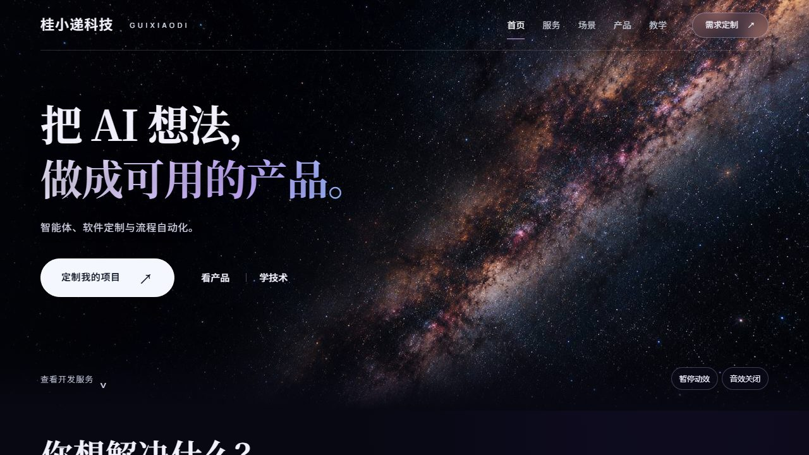
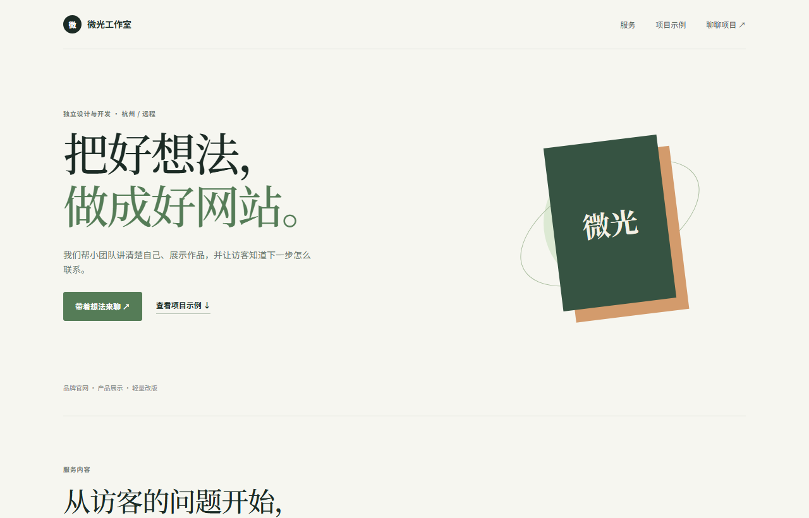
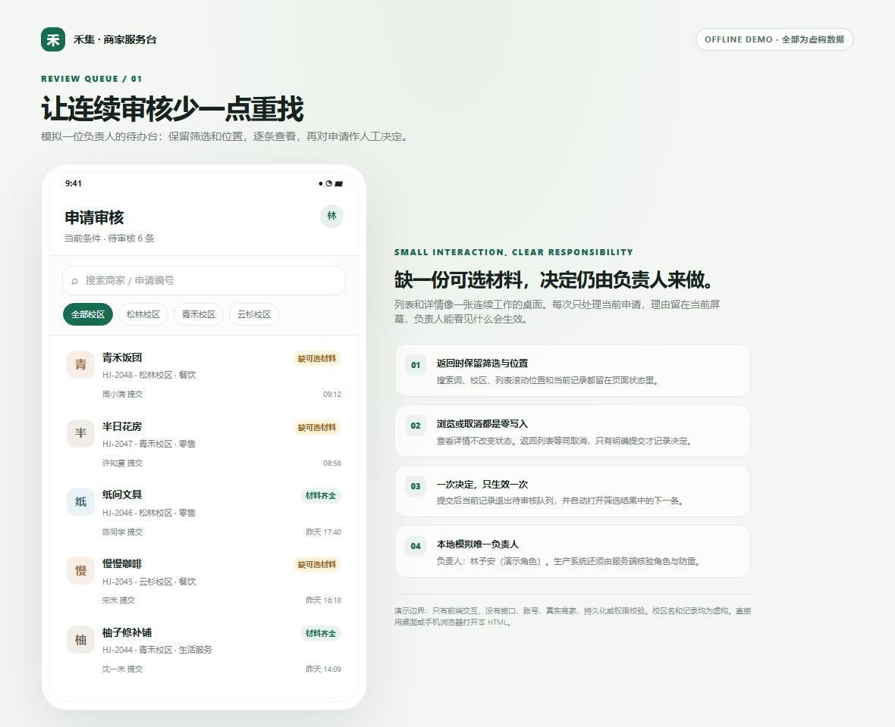

# Website Builder & Redesign

**One AI skill for website building, UI design, and improving existing websites or dashboards.** Start with an idea, URL, mockup, or codebase. The skill asks focused questions and works from your current stage. The guides and demos are in Chinese.

[Start with one request](#start-with-one-request) · [Eight layout patterns](references/layout-patterns.md) · [Design in practice](#design-in-practice) · [Build your first website](#build-your-first-website) · [Review or redesign a site](#review-or-redesign-a-site) · [Improve an admin app](#improve-an-existing-admin-app) · [Try 16 motion effects](#try-16-motion-effects) · [Download the skill](https://github.com/suhao1314/web-product-delivery/releases/latest/download/web-product-delivery.zip) · [中文](README.md)

## Install this skill

This repository contains one skill. For an assistant that discovers project skills in `.agents/skills/`, run the command from the root of your website project.

```sh
git clone https://github.com/suhao1314/web-product-delivery.git .agents/skills/web-product-delivery
```

The [ZIP download](https://github.com/suhao1314/web-product-delivery/releases/latest/download/web-product-delivery.zip) contains the same skill and its built-in examples. Extract `web-product-delivery` into your assistant's skill directory and reopen the project. A file-aware assistant can also read [SKILL.md](SKILL.md) directly.

### Update an existing installation

For a Git checkout, run the first two commands from the same project root. Run the third after confirming the remote is this repository and the working tree is clean.

```sh
git -C .agents/skills/web-product-delivery remote get-url origin
git -C .agents/skills/web-product-delivery status --short
git -C .agents/skills/web-product-delivery pull --ff-only
```

Back up local edits and review changes before updating. For a ZIP install, unpack the new copy outside the skills directory, save a backup of the old copy, replace the installed folder with the complete new folder, and reopen the project.

## Start with one request

> Use $web-product-delivery for my website. Ask me to confirm the requirements first. Deliver a desktop PNG/JPG and a mobile PNG/JPG UI image. After I approve both, present the development plan. Begin only after I explicitly approve that plan.

Every new task begins with questions and requirements confirmation. Any website change, including a small fix, requires the desktop and phone UI images and then an explicitly approved implementation plan. The bundled guide covers [eight layout patterns](references/layout-patterns.md) and the [ordered workflow](references/project-workflow.md#网站开发四步).

## Start with what you have

- **An idea.** Confirm the scope after questions, approve both desktop and mobile PNG/JPG design images, then explicitly approve the development plan.
- **A URL or screenshot.** Clarify which scenario to review and what result the user expects. Inspect and report within that scope.
- **An existing site or mockup.** Ask about the current task. Any actual edit still goes through UI image review and specific plan approval.

An assistant that discovers skills can use these requests directly. To invoke it explicitly, start with `$web-product-delivery`. [Skill entry point](SKILL.md)

## Design in practice

[](docs/guixiaodi-home.jpg)

The team behind the Gui Campus product also builds software and teaches AI. This desktop capture comes from a local build of its Guixiaodi company site. Three decisions show how the skill approaches visual and interaction design.

- **Where should the eye land?** A two-line Chinese serif headline sits against the dark part of the image. One smaller line names the services. A solid button invites a project inquiry, while two quieter links lead to products and classes. Check the crop and headline breaks again at phone width.
- **What should respond to a gesture?** The intended effect is slow dust close to the viewer, a distant moving galaxy and a local disturbance under the pointer. Review a still pointer, a short swipe, release and normal scrolling. A still image can show the composition. Depth and gesture response need a recording. For an admin app, apply the same attention to selection, submission feedback and restored focus. [Motion checks](references/motion.md)
- **Does the next screen remember the choice?** Choosing the inquiry link for AI 共创界 carries that product into the form. The visitor describes the request in one required field, can expand optional timing and budget fields, then generates a brief and can return to revise it. The button names the action precisely. A visitor sends the copied text through WeCom themselves.

> Use $web-product-delivery to review my homepage with the same headline in two layouts. Explain which one you would ship and why. Then follow a product inquiry at phone width and show whether it remembers the selected product.

At a 390-pixel browser width we followed the product detail link, checked both prefilled fields, generated a brief, went back to edit and generated it again. The capture shows the form on entry. [Phone-width inquiry capture](docs/guixiaodi-inquiry.jpg) · [UI design exercises (Chinese)](references/ui-design-practice.md) · [Company website](https://guixiaoyuan.site/)

## Build your first website

> Use $web-product-delivery to help me build my first site. I photograph campus events and want organizers to see my work and ask about a shoot with their date and requirements. Let's try it locally this week. Help me build a portfolio and an inquiry page, edit the headline myself, and complete one inquiry.

1. Discuss who will use the site, what they need to do, and how you will verify the first version. The assistant asks you what is still open.
2. Review and approve actual desktop and mobile PNG/JPG UI images with real content and key states. [Browser tab guide](references/site-identity.md)
3. After approving both images, read and explicitly approve the specific development plan. It explains page connections, how data is handled, and what will be tested.
4. Begin development after plan approval. For practice, open the bundled starter. [Four-step workflow](references/project-workflow.md#网站开发四步) · [Resume from recorded approvals](references/project-workflow.md#跨对话怎么接着做) · [First-site practice](references/build-your-first-site.md) · [First launch](references/first-launch.md)

[](assets/site-starter/index.html)

## Review or redesign a site

Ask about the user's issue, confirm the scope, and then follow the original path. Any change needs both UI design images and the later development plan approved. A small fix can annotate the affected states on the existing desktop and mobile interface. Compare the same entry point, data, role, and viewport after implementing the approved plan. [User journey review](references/journey.md) · [Redesign checks](references/visual-direction-and-change-control.md)

## Improve an existing admin app

> Use $web-product-delivery on this admin app. On a phone, the campus filter disappears when a reviewer closes a merchant application. Ask what should remain, then show desktop and mobile PNG/JPG designs. Present a plan after image approval and wait for my plan approval before making changes.

1. Open the maintained project and identify the usual entry point, reviewer role, and failing step. Repeat the task with a fixed viewport and filters.
2. After both image and plan approvals, restore the selected campus and focus. Check that switching campus clears the previous selection. Use separate test records to verify scope. [Admin workflows](references/admin.md) · [Drafts and recovery](references/convenience.md)
3. In the actual application's authorized test environment, repeat the same path from campus selection to the next application. Verify the active filter, focus, permission checks, and saved decision. [Ownership and exceptions](references/admin-ownership.md) · [Journey review](references/journey.md)

To practise with fictional records, open the bundled [offline review demo](examples/review-queue.html). Select 松林校区, open a record, and choose 返回申请列表（取消） to return. Check the active filter and focused record. Confirm a decision and see which record opens next. Refresh to start again.

[](examples/review-queue.html)

## Try 16 motion effects

Open the bundled [motion lab](assets/motion-lab/index.html) in a browser. Try spotlight, border beam, 3D tilt, and scroll-driven storytelling. The catalog covers where to use each effect, how it responds on touch screens, and what to check when shipping it. [Motion catalog](references/motion-patterns.md) · [Implementation and verification](references/motion.md)

## Other tasks

For a WeChat mini program with a companion website, confirm which tasks belong in the browser. Use this workflow for website work and coordinate the result with the approved team or process for the native side. [Cross-platform handoff](references/companion-workflow.md)

For a new site, choose a composition with real content. For an existing page, rank issues by their effect on the visitor and tune layout, motion or density independently. Develop unclear business rules through one observable user journey and check sensitive results at the service boundary. [Design decisions](references/visual-direction-and-change-control.md) · [Requirements and verification](references/feature-workflow.md)

- Bring a portfolio, product page, and inquiry form into the same visual system. [Design references](references/ui-reference.md)
- Diagnose slow first visits and touch gestures separately. [Motion](references/motion.md) · [Performance](references/delivery.md)
- Decide whether search, drafts, and onboarding solve an observed problem. [Feature selection](references/feature-tools.md)
- Investigate a control that looks the same but no longer works with a keyboard or accessible name. [Verification tools](references/verification-tools.md)

All three demos run locally without an account or Node.js. When reporting an issue, include the device, steps, and expected result using fictional data. The original skill and offline demos use the MIT License. The company screenshot illustrates the case study. Brand marks and third-party artwork retain their respective rights. [License](LICENSE) · [Research sources](references/sources.md)
