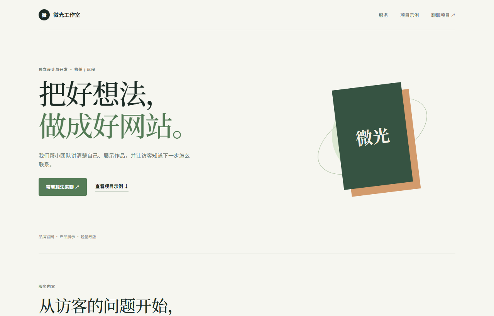

# Web Product Delivery

**让 AI 带你从一句想法做出第一个网站。** 一起想清楚网站给谁用，画出第一屏，写出能打开的页面，在自己的手机上试用，再把成品发布给别人。

[English](README.en.md) · [安装技能](#安装与使用) · [下载建站练习包](https://github.com/suhao1314/web-product-delivery/releases/download/v0.2.0/site-starter.zip) · [MIT 许可](LICENSE)

## 第一堂课

1. 解压上方练习包，双击 `index.html`。这是可在自己电脑上改的两页工作室网站，无需账号、域名或安装依赖。
2. 和 AI 改一处主标题和按钮颜色，保存、刷新，再从“山野咖啡”作品点到咨询页，填一句需求并生成可编辑的摘要。
3. 准备做自己的站时，告诉 AI 你的访客和目标。一起选首版范围、比较首屏、接入真实内容并验收。需要多人共享预约或团队登录处理时，技能会带你走有服务端的分支。[完整带做](references/build-your-first-site.md) · [第一屏设计](references/first-page-workshop.md) · [发布与接手](references/first-launch.md)

[](assets/site-starter/index.html)

## 它会怎样改一个页面

| 你遇到的事 | 技能关注的设计决定 | 交付时怎么验 |
| --- | --- | --- |
| “首页要有纵深，手机打开又得快” | 标题与咨询入口先可用。远云自主缓动，近尘从眼前掠过，指针只影响经过的一小片。 | 手机冷开录一次。先不碰，再扫过局部，松手后往下滚；同时检查减少动效偏好。[动效方法](references/motion.md) |
| “用户填到一半离开，又得重写” | 判断哪些输入值得保留，说明存在哪里。咨询摘要可编辑，复制后给出联系入口。 | 关页再进，恢复未写完的文本，再模拟复制失败。[输入与恢复](references/convenience.md) |
| “审核量一大，手机上一直找记录” | 队列保留范围、筛选和位置，详情展示决定所需的事实。 | 连续读过分页边界，关闭详情，刚读的记录和按钮仍在视口。[后台交付](references/admin.md) |
| “最后一位超管也被待核实卡住” | 可选缺件允许负责人走人工审核。外部回执未知时，给出查原单与登记进度的动作。 | 用一个有效超管走到可执行的下一步，核对取消、重复点击和刷新后的结果。[首管与人工处置](references/admin-ownership.md) |

## 安装与使用

在目标项目根目录执行下面的命令，将技能置于项目内。需要 Git，以及支持从 `.agents/skills/` 发现技能的开发助手。使用其他宿主时，将同一个目录放进它的技能目录即可。

```sh
git clone https://github.com/suhao1314/web-product-delivery.git .agents/skills/web-product-delivery
```

重新打开项目，在支持显式调用的助手中输入：

> 用 $web-product-delivery 带我从零做网站。我给校园社团拍照，希望社团看过作品后带着活动时间和拍摄需求来找我。本周先在自己的电脑上试。请带我做出第一页，让我亲手改一次，再走通咨询。

已有网站时也可以直接处理一个问题，例如“手机审核完返回，我总得从头找”。仓库附有独立的[审核队列演示下载](https://github.com/suhao1314/web-product-delivery/releases/download/v0.1.0/review-queue.html)和[界面实拍](docs/review-queue.png)。需要测首屏时，可选的 Node.js 脚本会使用已有的 Playwright 与 Chromium。[性能与交付指南](references/delivery.md)

## 按工作选入口

- **规划网站**　从访客要做的决定推导首页、产品、教学和咨询页的阅读顺序。[页面与品牌](references/pages.md)
- **挑组件，定动效**　按现有技术栈找到首选控件，用中文长文案、手机键盘和触控手势试一遍。[按页面选组件](references/page-components.md)
- **接手旧项目**　留一份同条件的起点，先修最费劲的一步，再看改动是否影响相邻流程。[按任务走查](references/journey.md)
- **交付验收**　把浏览器实测、模拟接口、真机和生产回读分别写清楚。输出可复查的操作和结果。[联合质量取舍](references/quality-gates.md)

向项目反馈时，最有价值的是一个能重走的例子。请附上界面任务、设备与输入方式、操作步骤，以及你原本期待的结果。公开 issue 请用虚构记录替换真实客户资料。

本项目的原创技能、文档、脚本与演示按 MIT 许可发布。可商用、修改和再分发，分发副本时保留版权及许可声明。参考资料由各自作者维护。[许可证全文](LICENSE) · [参考来源](references/sources.md)
